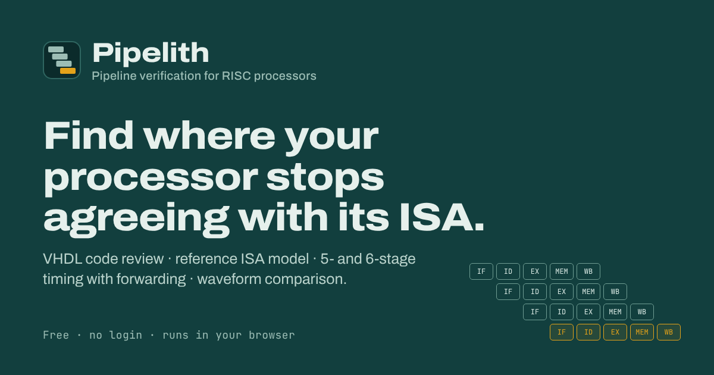

<p align="center"></p>

<h1 align="center">Pipelith</h1>
<p align="center"><strong>Pipeline verification for RISC processors</strong></p>



**Pipelith** (*pipeline* + *-lith*, as in monolith: rock-solid pipelines) is a browser-based workbench for **validating, testing and reviewing pipelined RISC processors**. Upload your VHDL and get a code review with suggested fixes, run programs on a reference model of the instruction set, simulate your design with a generated testbench, and see the first register, flag or fetch where your hardware stops agreeing with the ISA. Works with **5-stage and 6-stage** pipelines.

- **No login, no backend.** Code, programs, waveforms and reports never leave the browser. On Vercel, cookieless page-view and speed measurements are collected (path only, honours Do Not Track / Global Privacy Control, opt-out at `/privacy`).
- **Fast.** The model runs ~250,000 instructions per second, VCD files parse at ~50 MB/s, and a 28-file processor is reviewed in about 0.2 s — all in the tab.
- **Secure.** Strict nonce-based CSP, no third-party origins, bounded parsers, zip-bomb-safe intake, injection-safe code generation. See [SECURITY_AUDIT.md](SECURITY_AUDIT.md).
- **Guided.** Pick what you want to do, see exactly which files it needs, then follow Program → Assemble → Simulate → Check → Compare → Report.
- **Few steps.** *Run the demo* shows a real bug in one click; drop any files on the home page and each opens where it belongs; every review finding links to its rule's documentation.

It ships with a profile for the [pipelined RISC processor](https://github.com/ymahrous/risc-pipelined-processor) (32-bit, 8 registers, 4096-word Von Neumann memory), its four test programs, its RTL as a sample codebase, and GHDL waveforms of it.

## Fastest paths

| You want to | Do this | Clicks |
| --- | --- | --- |
| See what it does | **Run the demo** on the home page (or open `/try`): the bundled Memory test compared with a GHDL waveform of the reference processor | 1 |
| Review your VHDL | Drop your `.zip` (or `.vhd` files) on the home page | 1 drop |
| Compare your processor | Drop your program **and** its `wave.vcd` together on the home page — results open already compared | 1 drop |
| Check a program | Drop the `.asm` or `.mem` on the home page — it opens in Assemble | 1 drop |
| Check results without a waveform | Drop the program with a `.txt` of final register values | 1 drop |

The quick start routes files by name (`src/lib/util/routeFiles.ts`): `.zip`/`.vhd`/`.vhdl` → Code review; `.asm`/`.s`/`.mem` → Assemble; a program plus `.vcd`/`.vcd.gz` → Compare; a program plus `.txt` → Compare (final values). Anything else gets a message saying what it accepts. The demo asks before replacing a program you wrote yourself, and the *Bundled sample* option in Compare loads its waveform automatically.

## What you need

| Option | You provide | Where |
| --- | --- | --- |
| **Try it with a bundled test** | Nothing — test programs, a sample codebase and GHDL waveforms are included | Workbench |
| **Check a program** | Your program: `.asm` source or an assembled `.mem` image | Workbench: Program → Assemble → Simulate → Check → Report |
| **Test my processor** | Your program, plus results from your design: a `wave.vcd` waveform (the app's kit makes one) **or** the final register values. To make the waveform you need your RTL folder and GHDL or ModelSim/Questa. | Workbench: all six steps |
| **Review my code** | Your VHDL codebase: a `.zip`, a folder, or the `.vhd` files | Code review page |

For every option, describe your design with the **pipeline settings** shown on every scan (Program, Simulate, Compare and Code review — they are shared, so set them once):

- **Pipeline depth:** 5 stages (IF ID EX MEM WB) or 6 stages (IF ID EX1 EX2 MEM WB).
- **Forwarding allowed:** *Full forwarding* (default), *Some paths* (tick which of EX/MEM, MEM/WB — or EX1/EX2, EX2/MEM, MEM/WB — feed EX), or *No forwarding*.
- **Register file writes before it reads in the same cycle** (on by default): whether write-back and decode can share a cycle.

### Files the workbench accepts

| File | Where | What it is | Limit |
| --- | --- | --- | --- |
| `.asm` | Program | Assembly source. Comments such as `#R1=5` become checks; values on `IN` lines feed the IN port. | 512 KB |
| `.mem` | Program | Assembled image: one 32-digit binary word per line, from address 0 (the file your VHDL memory loads). | 4096 words |
| `.vcd` / `.vcd.gz` | Compare | Waveform of your design running **the same program**. Must contain clock, reset and R0–R7; SP, flags, OUT port and fetch PC enable the remaining checks. | 512 MB unpacked |
| `.txt` (or typed) | Compare | Final register values, e.g. `R1=19 R2=1E SP=FFF Z=0`. Paths like `/processor/r1` and `0x` prefixes are fine. Checks the end state only. | 8 KB |
| `.zip`, folder or `.vhd` files | Code review | Your whole VHDL design, including packages. Other files are ignored; `.asm` files are listed so you can open them. See [Structuring the .zip](#structuring-the-zip). | 1,500 files, 2 MB each, 50 MB zip |

Every file is read in the browser; nothing is uploaded to a server.

## Structuring the .zip

The review needs the **whole design**; the folder layout is up to you. The Code review page and the Guide show this explicitly (*How to structure your .zip*), and after upload a **structure check** says whether the upload looks complete.

```
my-cpu.zip
└── my-cpu/                 one top folder is fine — it is removed
    ├── rtl/                any folder names, any depth
    │   ├── cpu_pkg.vhd     required if any file says "use work.cpu_pkg"
    │   ├── alu.vhd         one entity per file, named after the entity
    │   ├── pipeline/       if_id / id_ex / ex_mem / mem_wb registers (or id_ex1, ex1_ex2, ex2_mem)
    │   ├── forwarding_unit.vhd
    │   ├── hazard_unit.vhd
    │   └── cpu.vhd         top level
    ├── tb/                 optional testbenches
    └── programs/           optional .asm files
```

- **Must include:** every `.vhd`/`.vhdl` file the design needs, including every package used via `use work.…`; one design per zip (no backup copies); UTF-8/ASCII text.
- **Ignored:** `work/`, `xsim.dir/`, `.Xil/`, `db/`, `incremental_db/`, `.git/`, `node_modules/`, `__MACOSX/`, and any file that isn't `.vhd`, `.vhdl`, `.vho`, `.asm` or `.s`. Verilog is listed as skipped.
- **Not supported:** zips inside the zip, password-protected or Zip64 archives, `.7z`/`.rar`.
- **Make one:** Windows *Send to → Compressed folder*; macOS *Compress*; Linux `zip -r my-cpu.zip my-cpu -i '*.vhd' '*.vhdl' '*.asm'`; or skip zipping and use *Choose a folder*. [`public/samples/reference-rtl.zip`](public/samples/reference-rtl.zip) is a layout that works.

## Code review

Upload the codebase and the review parses every VHDL file and reports findings in six categories. Each finding has a file and line, why it matters, a suggested fix (often with code) and the surrounding source.

| Category | Examples |
| --- | --- |
| Syntax | Unclosed `if`/`process`/`case` (pointing at the opener), mismatched `end`, broken literals |
| Structure | Architecture without entity, instance of a unit that doesn't exist (a warning when the file uses a vendor library), `use work.X` for a package not in the upload, duplicate entities, entity without architecture |
| Connectivity | Component declaration disagreeing with its entity (missing ports, wrong mode or width), unknown or unconnected ports, width mismatches, multiple drivers, undriven signals, assignments to inputs, unused inputs such as an ignored reset |
| Processes | Incomplete sensitivity lists, latches, logic outside the clock edge, clock or async reset missing from the list, `case` without `when others`, mixed reset polarity, delays in RTL |
| Pipeline (depth- and forwarding-aware) | Expected pipeline registers, stages and hazard unit for the selected depth; selected forwarding paths missing from the forwarding unit, a forwarding unit when *No forwarding* is selected, no hazard unit when stalls are required; fields latched but never passed on; a warning if the code looks like the other depth |
| Style | Non-standard arithmetic packages, unconstrained integers, initial values, file/entity name mismatch |

The **Design overview** shows the hierarchy from the top-level entity and a dependency-ordered compile list, which you can send to the hardware kit with one click. Export the review as Markdown or JSON.

Run on the reference processor (6 stages selected), it reports 0 errors, 6 warnings and 18 notes, including: `pc` and `control_unit` never read their reset input, `control_unit` assigns six signals outside the clock edge, and the `if_id_register` / `execute1_stage` component declarations are missing the `imm_follows_out` / `alu_flags_out` ports that GHDL also warns about. With 5 stages selected it warns that the code is a 6-stage design.

## Pipeline depth and forwarding

The instruction set — and so the reference model and every check — is the same for both depths. The depth changes:

| | 5 stages | 6 stages |
| --- | --- | --- |
| Stages | IF → ID → EX → MEM → WB | IF → ID → EX1 → EX2 → MEM → WB |
| Pipeline registers | IF/ID, ID/EX, EX/MEM, MEM/WB | IF/ID, ID/EX1, EX1/EX2, EX2/MEM, MEM/WB |
| Forwarding into EX from | EX/MEM, MEM/WB | EX1/EX2, EX2/MEM, MEM/WB |
| Conditional branch resolved in | EX | EX2 |
| Load-use stall with full forwarding (dependent instruction right behind) | 1 cycle | 2 cycles |

**Forwarding** changes the data-hazard cost. With full forwarding only load-use hazards stall. With *Some paths*, a dependency whose producing result sits in a disabled path waits for a later enabled path or for the register file. With *No forwarding*, every dependent instruction waits until write-back (one cycle longer if the register file can't write before it reads). These stalls appear as *Data-hazard stalls (no forwarding path)* in the breakdown, and the testbench, timing verdict, code review and reports all name the forwarding mode they were checked against.

- **Simulate** shows a cycle estimate, the stall breakdown (load-use, data hazards without forwarding, taken branches, immediate words, shared memory port, multi-cycle instructions) and a pipeline diagram for the selected depth.
- **Compare** sizes the testbench from the estimate, tries the depth's usual signal names, and says whether your design's cycle count fits the depth. On the reference RTL the 6-stage estimate for OneOperand.asm is exactly the 17 cycles GHDL takes.
- **Code review** checks the depth's pipeline structure and the selected forwarding paths.

## The workbench steps

| Step | What happens |
| --- | --- |
| **1 · Program** | Choose an option and the pipeline settings (depth, forwarding); pick a bundled test, open an `.asm` or `.mem` file, or write one. |
| **2 · Assemble** | Bit-exact with the project's `assembler.py` (verified against its output), but reports *all* errors and flags silent mistakes: overlapping `.ORG` regions, a bare `ADD` stored as `0xADD`, immediates wider than the documented field, register-form `IADD`, out-of-range targets, missing reset vector. |
| **3 · Simulate** | One-instruction-per-step reference model with time-travel stepping, register/flag/SP/memory views, a trace, and pipeline timing. IN-port values come from comments and can be overridden; interrupts can be scheduled; ambiguous spec points (IADD sign extension, SUB carry, IN flags, interrupt flag push) are explicit options. |
| **4 · Check** | Comments such as `#R1=5`, `SP=FFE`, `M[FFF]=300`, `C --> 1`, `flags no change`, `shouldn't be executed`, `taken` become assertions. Add your own final-state checks. |
| **5 · Compare** | A **waveform** (download a kit with the program image, a VHDL-2008 testbench and GHDL/ModelSim scripts; drop in `wave.vcd`), the **final register values**, or the **bundled sample**. Each register, SP, the flags and the OUT port must take the same sequence of values as the model; the fetch PC is checked for jumps outside the program; the first divergence is highlighted with the instruction that should have produced the value; the cycle count is checked against the depth. |
| **6 · Report** | Export Markdown or JSON, print to PDF, or copy a share link (the program travels in the URL fragment, which is never sent to a server). |

## What it found in the reference design

Running the project's own test programs through GHDL with the generated testbench:

| Program | Result |
| --- | --- |
| `TwoOperand.asm` | Hardware matches the model on every channel. The test's comment for `MOV R3, R5` assumes the opposite operand order from the ISA and assembler. |
| `OneOperand.asm` | Registers and OUT match, in exactly the cycles the 6-stage estimate predicts. `IN` and `SETC` change Z/N in the RTL, which the ISA says they don't. |
| `Memory.asm` | `PUSH` stores R0 instead of the named register (the memory-stage write-data mux uses `read_data_2`, but PUSH encodes its register in Rsrc1), so `POP` returns 0. |
| `Branch.asm` | After the first taken `JZ`, the fetch PC jumps to `0x10000000` — the encoding of the following `SETC` — and runs off the end of memory. |

## Quick start

Requirements: Node.js 20.9+ (22 recommended).

```bash
npm install
npm run dev          # http://localhost:3000
```

Production:

```bash
npm run build
npm start            # http://localhost:3000
```

Deploy anywhere that runs a Next.js server (Vercel, a container, a VM). Keep `src/proxy.ts` — it sets the Content-Security-Policy.

| Environment variable | Default | Effect |
| --- | --- | --- |
| `NEXT_PUBLIC_SITE_URL` | `https://$VERCEL_PROJECT_PRODUCTION_URL`, else `http://localhost:3000` | Canonical URL for metadata, sitemap, robots, JSON-LD and Open Graph |
| `NEXT_PUBLIC_DISABLE_ANALYTICS` | unset | Set to `1` to turn off Vercel Web Analytics and Speed Insights |

**Analytics.** Vercel Web Analytics and Speed Insights are rendered only when `VERCEL=1` (set automatically on Vercel), so self-hosted copies load nothing. Enable both in the Vercel project dashboard. Before any event is sent the URL is reduced to origin + path (no query, no `#` share-link fragment), and nothing is sent when the browser has Do Not Track or Global Privacy Control on, or the visitor ticked the opt-out on `/privacy`. The scripts are served from the site's own origin, so the CSP is unchanged.

**Legal pages.** `/privacy` and `/terms` are written for the operator named in `src/lib/site.ts` (`author`, `repo`, `legalUpdated`). If you run your own copy, update those values and review the text for your jurisdiction and contact details — this is not legal advice.

## Documentation in the app

| Page | What it covers |
| --- | --- |
| `/docs` | Task-first overview: “I want to…” rows with the shortest path to each goal, plus every reference page |
| `/guide` | Full walkthrough: options, pipeline depth and forwarding, the .zip structure, running GHDL/ModelSim/Vivado, reading results |
| `/docs/checks` | Every comment syntax that becomes a check (`#R1=5`, `SP=FFE`, `M[FFF]=300`, `C --> 1`, `flags no change`, `shouldn't be executed`, `taken`) and IN-port values. Its worked example is run by a unit test |
| `/docs/review-rules` | All 47 Code review rules with severity, why it matters and the fix. Generated from `src/lib/review/rules.ts`, which a test keeps identical to the rules the engine emits; findings link to `#rule-id` |
| `/docs/troubleshooting` | Fixes keyed to the app's real messages: uploads, missing packages, assembler errors, GHDL/ModelSim compile order, VHDL-2008, unmapped signals, short waveforms, timing |
| `/docs/glossary` | 24 pipeline and verification terms, one sentence each |
| `/isa`, `/faq` | Instruction set reference; short answers |

The header has four items (Workbench, Code review, Docs, FAQ). The footer has three groups — Product, Docs, Legal — and one line of fine print.

## Search, answer engines and sharing

- Per-page titles, descriptions and canonical URLs; Open Graph and Twitter images (`src/app/opengraph-image.png`).
- JSON-LD (nonce-tagged, `<` escaped): `WebSite` on every page, `WebApplication` on the landing page, `HowTo` on the Guide, `FAQPage` and `BreadcrumbList` on `/faq`; `TechArticle` and `BreadcrumbList` on every `/docs` page, plus `DefinedTermSet` on the glossary and `FAQPage` on troubleshooting. Visible breadcrumbs match.
- `/try` is `noindex` (it changes the visitor's session); every documentation page is in the sitemap.
- `/robots.txt` allows all crawlers, including AI answer engines (GPTBot, ClaudeBot, PerplexityBot, Google-Extended…); `/sitemap.xml`; `/manifest.webmanifest`.
- `/llms.txt`: a plain-text summary of what the tool does, the quick paths, every docs page, all review rules, the glossary and the FAQ, for LLM-based assistants.
- The landing page opens with a one-paragraph definition and the FAQ answers questions in their first sentence, so answer engines can quote them directly. FAQ content lives in `src/lib/content/faq.ts`.

## Running your hardware

From the Compare step, download the kit and run:

```bash
unzip program-hardware-run.zip -d run && cd run
chmod +x run_ghdl.sh
./run_ghdl.sh path/to/your/src/rtl     # writes wave.vcd
```

ModelSim/Questa: edit `set RTL …` at the top of `run_modelsim.do`, then `do run_modelsim.do`. Vivado's simulator works too (`open_vcd` / `log_vcd`; see the in-app guide). For your own design, run **Code review** first and choose *Use this order in the hardware kit* so the scripts compile your files in dependency order.

The testbench holds reset across a full falling and rising edge (the reference design loads PC from M[0] on that pair of edges), drives `in_port` from the fetch PC so each IN reads the value the model used, and pulses `int` when a chosen address is fetched.

## Scripts

| Command | Does |
| --- | --- |
| `npm run dev` | Development server |
| `npm run build` / `npm start` | Production build / server |
| `npm test` | Unit tests (Vitest): assembler, model, pipeline timing and forwarding, checks, VCD parser, comparison, code review, security |
| `RTL_DIR=… npm test` | Also runs the GHDL round trip against real RTL (needs `ghdl`) |
| `npm run test:e2e` | Playwright end-to-end tests on desktop and mobile; fails on any console error or CSP violation |
| `npm run lint` / `npm run typecheck` | ESLint / TypeScript |
| `npm run check` | Typecheck + lint + unit tests + build |

## Project layout

```
src/
  app/                    Routes: landing, /try, /workbench/*, /review, /docs/*, /isa, /guide, /faq, /privacy,
                          /terms, /license, robots.ts, sitemap.ts, manifest.ts, llms.txt, Open Graph images
  components/             UI: pipeline stepper, step pages, editor, session provider,
                          DepthPicker (PipelineSettings), QuickStart + useQuickStart, TryDemo,
                          DocsNav, DocPage, Breadcrumbs, SiteFooter, JsonLd, VercelMetrics, AnalyticsOptOut
    review/               Code review page and ZipGuide
  lib/
    isa/                  Processor profiles (ISA definition + hardware binding)
    asm/                  Assembler, .mem import, disassembler
    sim/                  Reference ISA model
    pipeline/             5/6-stage geometry, timing estimate, pipeline diagram data
    check/                Comment-to-assertion parser and evaluator
    vcd/                  Streaming VCD parser (plain and gzip)
    compare/              Model-vs-waveform sequences, final values, timing verdict
    review/               Codebase intake (zip/folder), VHDL lexer and parser, review rules, rules.ts catalog
    tb/                   Testbench and script generator
    session/              Session state, validation, share links, analysis pipeline
    report/               Markdown / JSON reports
    content/              FAQ, docs map, glossary, troubleshooting, the /docs/checks example
    util/                 Downloads, quick-start routing, storage migration, privacy helpers
    site.ts               Site name, URL, operator, legal dates, metricsEnabled()
  proxy.ts                Per-request nonce + CSP
  app/icon.svg            Logo mark (also the favicon); apple-icon.png, opengraph-image.png, twitter-image.png
public/samples/           Reference RTL (zip) and GHDL waveforms
e2e/                      Playwright tests
```

## Using it with another processor

Different signal names: open **Signal mapping** under the Compare results. Different pipeline depth or forwarding: change the pipeline settings. A different ISA: add a profile in `src/lib/isa/` — see [CONTRIBUTING.md](CONTRIBUTING.md#adding-a-processor-profile).

## Limits

Source ≤ 512 KB, memory 4096 words, ≤ 200,000 model steps, VCD ≤ 512 MB, code review ≤ 1,500 files. Memory contents are not compared (most dumps don't include memory arrays). Interrupt timing in a pipeline differs from an instruction-level model, so interrupt tests are best-effort. The timing estimate models an in-order pipeline with the forwarding you select; treat it as a guide, not a specification. The code review is static analysis: it can't find logic bugs — the simulation steps do that. Verilog/SystemVerilog files are not reviewed yet.

## Documentation

- [CONTRIBUTING.md](CONTRIBUTING.md) — development workflow, tests, adding profiles and review rules
- [SECURITY_AUDIT.md](SECURITY_AUDIT.md) — threat model, controls, findings
- [SECURITY.md](SECURITY.md) — reporting vulnerabilities
- In the app: `/docs`, `/guide`, `/faq`, `/privacy`, `/terms`
- [AGENTS.md](AGENTS.md) / [CLAUDE.md](CLAUDE.md) — instructions for AI coding agents

## License

[MIT](LICENSE) © 2026 Yousef Mahrous — free to use, modify and redistribute, including commercially, as long as the copyright notice stays. The license is also shown in the app at `/license`. Bundled test programs, the sample RTL and sample waveforms come from [ymahrous/risc-pipelined-processor](https://github.com/ymahrous/risc-pipelined-processor) (MIT, © 2026 Yousef Mahrous).
